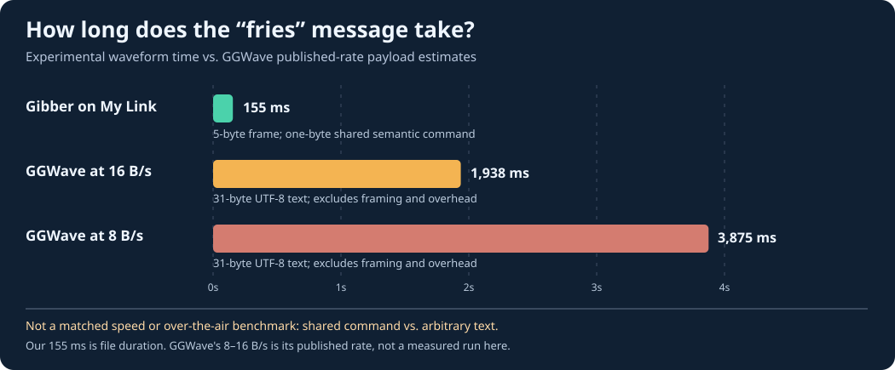

# Gibber on My Link 🔊

**Experimental low-latency, sound-based AI-to-AI messaging proof of concept.**

This prototype doesn't send the whole sentence “would you like fries with that?” over a speaker. Instead, two cooperating agents share a dictionary in advance and transmit the *command ID* `0x21`. The receiving agent looks up that ID to recover the phrase. The audio transport is a custom OFDM + QPSK demonstration implemented in Python.

> **Important:** This is not GGWave/GibberLink-compatible. The current experiments are file-to-file and simulated-noise tests, not measured speaker-to-microphone performance. The dictionary is predefined; this is not general-purpose semantic compression or a new AI language.

## Quick start

Requires Python 3.10+ and NumPy/SciPy.

```bash
python -m venv .venv
source .venv/bin/activate  # Windows PowerShell: .venv\Scripts\Activate.ps1
pip install -r requirements.txt

# Produce a 48 kHz, 16-bit mono WAV with the 0x21 command
python gibber.py encode samples/gibber_fries.wav

# Decode it and verify the CRC-16 check
python gibber.py decode samples/gibber_fries.wav

# Run simulation with additive noise
python gibber.py test

# Run extra unit tests
python -m unittest discover -s tests -v
```

Expected decoder output:

```text
Synchronized at sample 384
CRC-verified packet: 47 01 21 53 d3
Decoded command: 0x21 -> would you like fries with that?
```

## Listen

- [`samples/gibber_fries.wav`](samples/gibber_fries.wav): one **~155 ms** transmission.
- [`samples/gibber_fries_repeat_4x.wav`](samples/gibber_fries_repeat_4x.wav): the same transmission repeated four times with pauses so it's easier to hear. Repeated-audio duration is **not** one transmission's latency.

## How it works

```text
Original sentence
        |
        v
Shared semantic dictionary (0x21)
        |
        v
Packet: MAGIC | VERSION | COMMAND | CRC-16
        |
        v
Bit repetition + interleaving
        |
        v
QPSK on 64 OFDM subcarriers
        |
        v
48 kHz WAV audio
        |
        v
Sync chirp + channel training + OFDM decode
        |
        v
Majority vote + CRC verification
        |
        v
0x21 -> original sentence
```

The single-burst WAV includes a sync chirp, an OFDM training symbol, three redundant data symbols, and short leading/trailing silence. See [`docs/PROTOCOL.md`](docs/PROTOCOL.md).

## C++20 implementation (Windows and Linux)

The `cpp/` implementation is a native C++20 codec with a built-in radix-2 FFT,
no C++ third-party dependencies, and the **same wire format as the Python codec**.
Pilot symbols and interleaver permutation tables are pinned to the Python v0.1
NumPy-generated tables. Files made in either language decode in the other.

```bash
cmake -S . -B build -DCMAKE_BUILD_TYPE=Release
cmake --build build --config Release
ctest --test-dir build -C Release --output-on-failure

# Linux/macOS:
./build/gibber_cpp encode samples/from_cpp.wav
./build/gibber_cpp decode samples/gibber_fries.wav

# Windows (PowerShell, with MSVC):
.\build\Release\gibber_cpp.exe encode samples\from_cpp.wav
.\build\Release\gibber_cpp.exe decode samples\gibber_fries.wav

# Cross-language WAV compatibility (Linux; use .exe path on Windows):
python tests/test_interop.py --binary build/gibber_cpp
```

The [C++ automated workflow](.github/workflows/cpp-ci.yml) compiles/tests
both Linux and Windows and checks C++-to-Python WAV identity and Python-to-C++ decoding.
This remains a **file/PCM proof of concept**, not a live microphone implementation.

## Comparison with GibberLink / GGWave



**Read the [methodology and limitations](docs/COMPARISON.md).** Our 155 ms
waveform sends a pre-agreed **one-byte command** (inside a five-byte packet).
The GGWave estimate sends the complete **31-byte sentence** at its published
8–16 bytes/second rate. These are different payloads and not a matched
speaker-to-microphone benchmark: we have not demonstrated superior general
modem throughput, range or real-world reliability.

## Goals and limitations

- **Demonstrated:** clean local WAV encode/decode and reproducible simulated additive-noise decode tests, using the included fixed command.
- **Not demonstrated:** reliable over-the-air operation between arbitrary phones, laptops, or sound cards.
- **No cryptographic authentication:** checksum verifies accidental corruption, **not** identity or integrity against attackers.
- **One fixed phrase:** new arbitrary text requires defining additional commands and updating both agents or creating a structured-data fallback.
- **No handshaking or acknowledgements:** a message can be lost or duplicated, and there is no retry system yet.
- **Audio duration isn't end-to-end latency:** real-world latency also includes audio I/O buffering, propagation, synchronization, decoding, and app processing.

## Roadmap

1. Live microphone/speaker loopback and recordings on two physical devices.
2. Measure end-to-end latency, delivery success, and false-positive rate across noise/distance/device types.
3. Add packet sequence numbers, acknowledgement/retry, and versioned shared dictionaries.
4. Add authenticated commands and a compact binary payload fallback for arbitrary information.
5. Add live acoustic I/O through PortAudio (C++ implementation already available), then evaluate adaptive modulation and coding.

## Repository status

Proof of concept, v0.1. No software license has been selected yet; do not assume permission to reuse or redistribute beyond applicable law until a license is added.