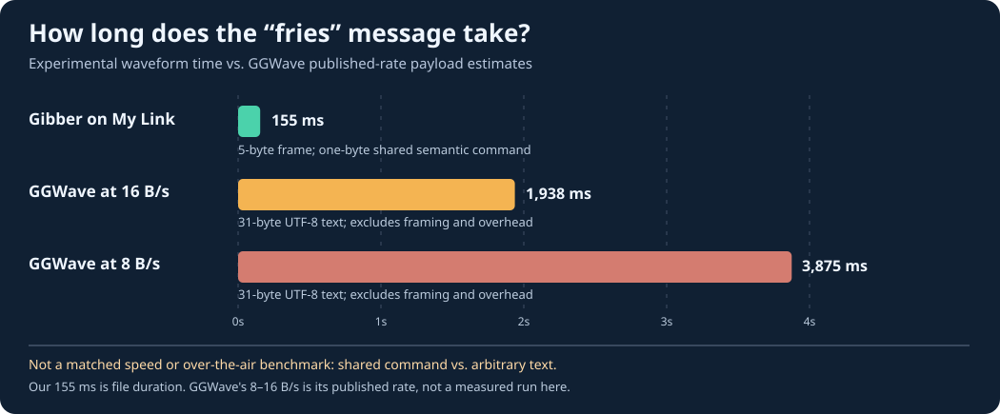

# Protocol comparison: Gibber on My Link vs. GibberLink / GGWave

For the exact phrase `would you like fries with that?` (31 bytes in UTF-8), this project sends the shared dictionary command `0x21`, **not** the phrase. The other endpoint must have the same dictionary already installed.

| Feature | Gibber on My Link | GibberLink using GGWave |
| --- | --- | --- |
| Modulation | 64-carrier OFDM with QPSK | GGWave FSK with error correction |
| Application payload in this example | One fixed, predefined 1-byte command | 31-byte arbitrary UTF-8 text |
| Frame data | 5-byte header/command/CRC packet with repetition | GGWave framing and error correction |
| Signal time | **154.67 ms** waveform (7424 samples at 48 kHz) | **1.94–3.88 s payload-time estimate**, from 31 bytes / published 16–8 bytes per second, *excluding overhead* |
| Arbitrary text? | No; both endpoints need a shared dictionary | Yes, supports arbitrary short payloads |
| Interoperable? | Not GGWave compatible | Uses GGWave |
| Physical speaker-to-microphone tests | Not yet | GGWave has demonstrations, but no matched test run here |

**Caution:** This is not a head-to-head performance measurement. The payloads are different (pre-agreed command versus arbitrary text). GGWave could transmit a pre-agreed one-byte command too. Likewise, our current demo cannot transmit arbitrary sentences. Our duration is a WAV length, not end-to-end latency. The GGWave durations are *theoretical payload-only estimates*, not measured recorded audio. We make no fair speedup claim until both use the same content, devices, room, and reliability target.

### Calculation

- `7424 / 48000 = 0.1546667 seconds` (our waveform duration).
- `31 / 16 = 1.9375 seconds` (GGWave published top-end payload rate).
- `31 / 8 = 3.875 seconds` (GGWave published low-end payload rate).
- `31 / 1 = 31` raw application bytes per command byte, **not** a measured throughput multiplier.

### References

- [GibberLink original implementation](https://github.com/PennyroyalTea/gibberlink) — agents switch to GGWave.
- [GGWave official README](https://github.com/ggerganov/ggwave) — FSK library, documented 8–16 bytes/sec bandwidth.

### Next: fair field test

Use the same speaker/microphone hardware to transmit both full 31-byte text and pre-agreed 1-byte command over each modem, then record P50/P95 latency, success rate, retries, distance, sound level and background noise. Only then claim an acoustic-modem speed advantage.
